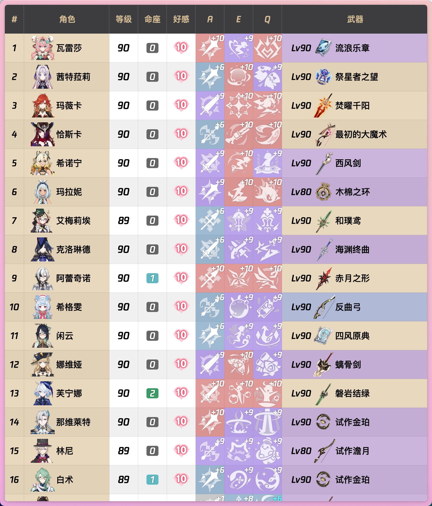

# Better Miyoushe

> readme version: 2026.11.24

Make Miyoushe Great Again

让米游社再次伟大！！！

美化米游社页面，移除页面冗余内容。

---

美化后首页显示效果，以及右下角侧边按钮


角色列表界面（样式参考 yunzai-bot）



---

侧边按钮指南


TODO

- [x] 角色列表
- [x] 调整按钮逻辑，增加刷新按钮，分离移动和点击事件

---

## 安装脚本

1. 在 Chrome 或其他 Chromium 浏览器中安装 Tampermonkey。
2. 打开 [Better Miyoushe 的 Greasy Fork 页面](https://greasyfork.org/zh-CN/scripts/530831-better-miyoushe)，点击「安装此脚本」。

## 本地开发

在包含 `package.json` 和 `blob-html/` 的仓库根目录运行。GitHub Actions 使用 Node.js 24 和 pnpm 10.10.0。

```sh
pnpm install
pnpm --dir blob-html install
pnpm dev
```

用装了 Tampermonkey 的浏览器打开终端显示的 Vite 地址，安装开发版脚本，然后打开或刷新米游社测试。主项目会自动启动 `blob-html` 的开发服务。若已安装正式版，可以先在 Tampermonkey 中停用它，避免两个版本同时生效。

## 本地打包

安装两边依赖后，在仓库根目录执行构建命令。

```sh
pnpm build
```

构建会自动打包 `blob-html`，将角色列表页面嵌入 `dist/better-miyoushe.user.js`。可以把这个文件导入 Tampermonkey 测试，脚本的 `@version` 来自根目录的 `package.json`。

## 提交并推送代码

提交标题沿用仓库的 `[类型] 英文说明` 格式，例如 `[fix]`、`[feat]` 或 `[docs]`。以下命令以提交 README 为例。

```sh
git status --short
git add -- README.md
git diff --cached
git commit -m "[docs] update development and release guide"
git push
```

首次推送且当前分支还没有上游时，用 `git push -u origin HEAD`。日常推送分支只会更新 GitHub 上的源码，发布工作流由版本 tag 的推送触发。

## 发版

1. 切到 `main`，确认要发布的代码已提交。运行 `git status --short` 检查暂存区，避免把其他改动带进发布提交。
2. 在 [CHANGELOG.md](CHANGELOG.md) 的 `## [Unreleased]` 下写本次更新内容。
3. 在仓库根目录执行 `pnpm run release patch`。例如从 `1.4.0` 升到 `1.4.1`。也可以用 `minor`、`major`，或直接指定版本，例如 `pnpm run release 1.4.1`。

[发版脚本](scripts/release.js) 会更新 `package.json`，将 `Unreleased` 下的内容归入新版本，创建 `[chore] release vX.Y.Z` 提交和带注释的 `vX.Y.Z` tag，然后依次推送当前分支和 tag。

## GitHub Actions 和 Greasy Fork 自动更新

推送 `vX.Y.Z` 格式的 tag 后，GitHub 会自动运行 [Publish to GreasyFork](.github/workflows/publish-greasyfork.yml)。

1. 检出 tag 对应的提交，安装 Node.js、pnpm 和两个项目的依赖。
2. 核对 tag 与 `package.json` 的版本号，读取 `CHANGELOG.md` 中该版本的更新说明。
3. 运行 `pnpm build`，在已有的 `dist` 分支上提交并推送新版 `better-miyoushe.user.js`。提交说明使用当版 changelog，Greasy Fork 通过 GitHub webhook 同步脚本和版本历史。更新说明为空时，提交说明使用 `Release vX.Y.Z`。
4. 创建 GitHub Release，上传 `better-miyoushe.user.js`，并附上 changelog 和 GitHub 自动生成的发布说明。

发版后，在 GitHub 仓库的 **Actions** 中打开对应 tag 的运行记录，确认任务成功。再检查 **Releases** 里的脚本附件，以及 Greasy Fork「历史」里的新版本和更新说明。Tampermonkey 会按扩展设置检查更新，也可以在扩展里手动检查。

本项目仅供学习参考使用，最终解释权归米哈游所有
